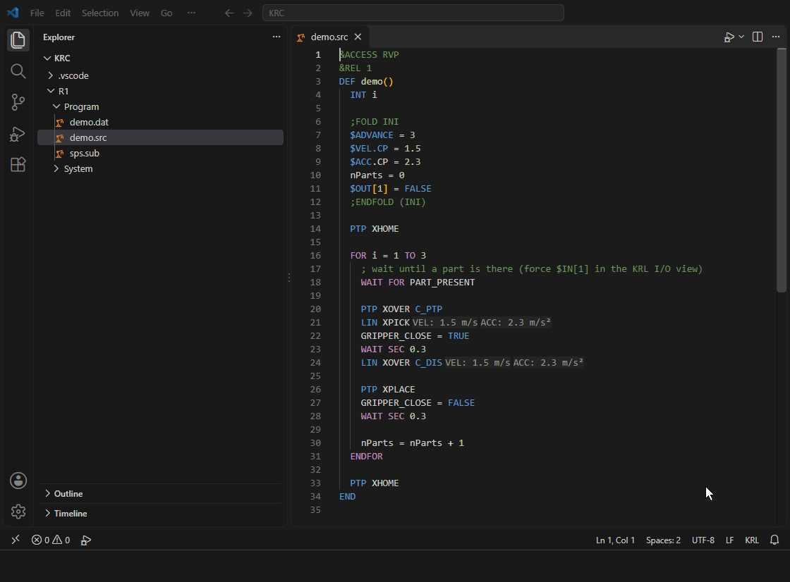

# KUKA KRL OfficeLite

Write, check and test KUKA KRL programs in VS Code: completion, errors and quick fixes while you type, a formatter, and a debugger that simulates the robot controller. Step through `.src` / `.sub` programs without a robot and without OfficeLite.



## Features

**Editor**

- Completion that knows where the cursor is: points after `PTP` / `LIN`, structure members, ENUM literals, system variables; statement templates.
- Errors and warnings for the whole robot project, with quick fixes: syntax, undeclared names and points, block structure, `;FOLD` pairs, I/O ranges, velocity limits, unused declarations.
- Hovers with positions in mm / ° and decoded Status / Turn, signature help, inlay hints for VEL / ACC / APO.
- Go to definition and references across `.src`, `.dat` and `$config.dat`.
- `;FOLD` folding like on the smartPAD, formatter, file icons.

**Debugger: the robot controller simulated**

- Robot and submit interpreter (`SPS.SUB`) side by side, sharing globals and system variables; breakpoints, stepping, variables of every scope.
- Advance run (`$ADVANCE`) and main run in the gutter; motions take as long as on the robot, from `Mada/$machine.dat`.
- Override (up to 10000 % to run faster) and operating mode (T1, T2, AUT, EXT) in the debug toolbar.
- Views **KRL I/O** (force inputs), **KRL Robot**, **KRL Messages** (`SET_KRLMSG` / `SET_KRLDLG`), **KRL Live Watch** and **Search Variables**.
- While stopped: change values with one click, select a block with **Jump to Cursor**.
- Errors stop the program where the controller would; set the value and continue.

## Getting started

1. Open the folder of a robot backup (`KRC` with `R1/System/$config.dat` and `R1/Mada/$machine.dat`) or of your KRL programs. Without `$config.dat`, names such as `XHOME` or `BAS` are reported as not declared.
2. Open a `.src` file and press **F5**, no `launch.json` needed.

Requires VS Code 1.67 or newer, nothing else. To try it, open [`examples/KRC`](https://github.com/danielmuellernavarro/krl-officelite/tree/main/examples), then `R1/Program/demo.src`, and press F5.

To have colleagues asked to install the extension, add `.vscode/extensions.json` with `{ "recommendations": ["krl-officelite.krl-officelite"] }`.

If another extension opens `.src` / `.dat` files (e.g. RoboDK's *Industrial Robots*), choose **Open as KRL** when the extension offers it.

## Settings and launch configuration

Settings start with `krl-officelite.`: checks (`diagnostics.*`), inlay hints, folding, the formatter (`formatOnSave`, `indentwidth`, ...) and the simulation at the start (`simulation.override`, `simulation.mode`).

To choose the programs, add to `.vscode/launch.json`:

```json
{
  "type": "krl",
  "request": "launch",
  "name": "KRL: Debug",
  "program": "${workspaceFolder}/R1/Program/cell.src",
  "submitPrograms": ["${workspaceFolder}/R1/System/sps.sub"]
}
```

Optional: `stopOnEntry`, `configDat`, `machineData`, `sources`, `override`, `mode`.

## Development

`npm install`, then F5 in this repository opens an Extension Development Host. `npm test` runs the tests.
