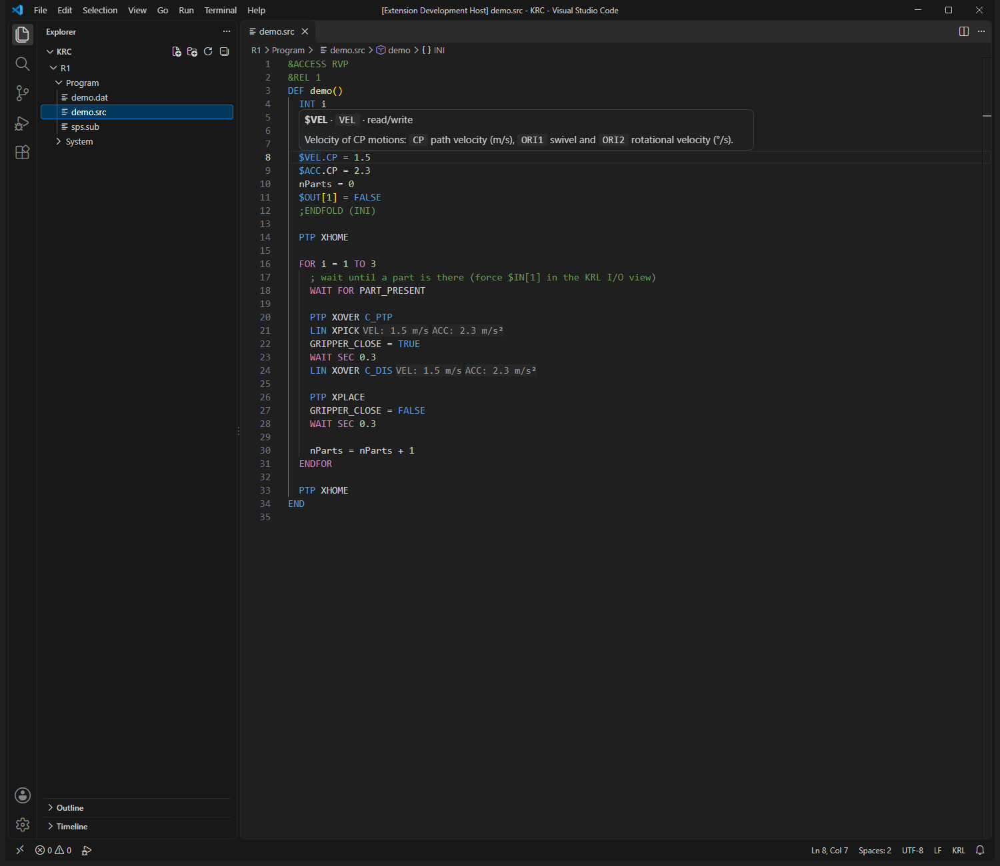
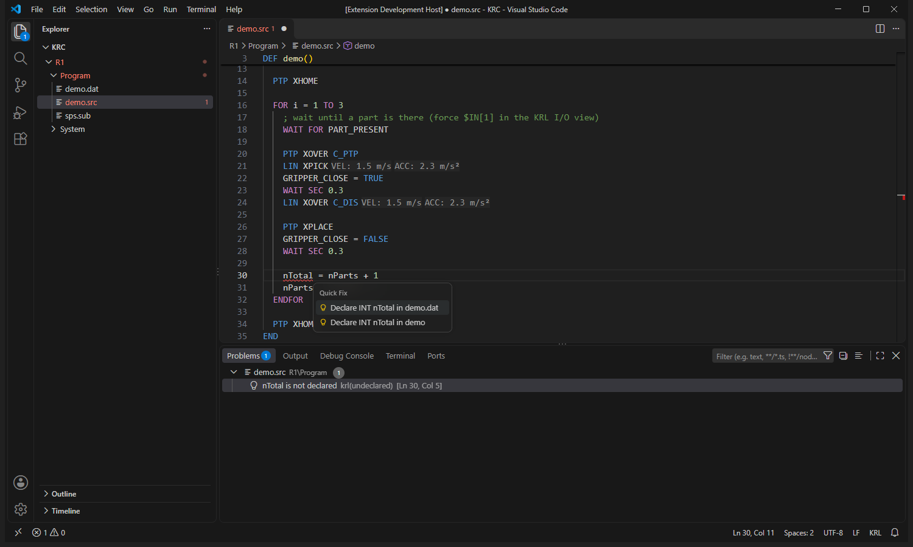
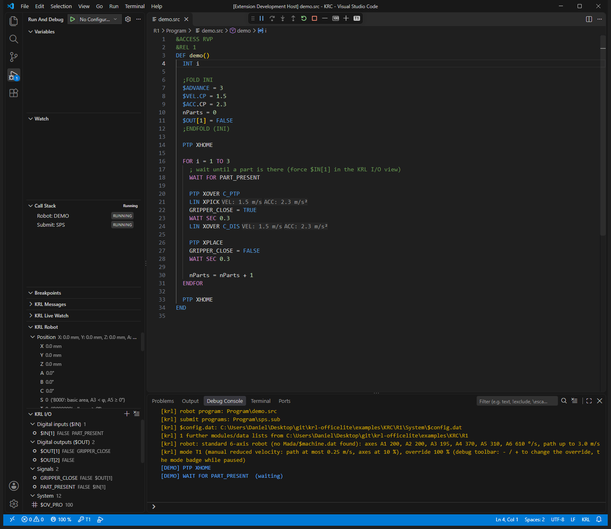
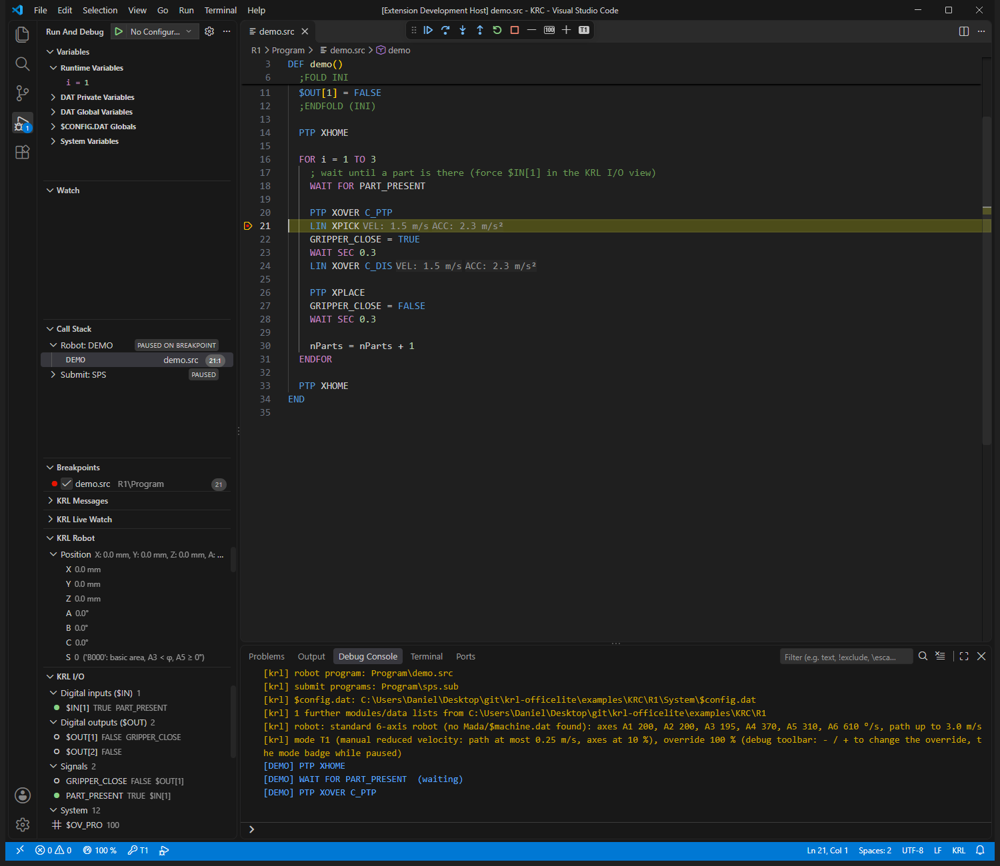

# KUKA KRL OfficeLite

Write, check and test KUKA KRL programs in VS Code: completion that knows your robot project, errors and quick fixes while you type, a formatter, and a debugger that simulates the robot controller, so you can step through `.src` / `.sub` programs without a robot.

**Test KRL without a robot and without OfficeLite.** Press F5 on a program and watch the simulated robot move, force inputs, change the override and the operating mode.

## Screenshots

Hovers show system variables with their documentation and positions with units; motions get inlay hints for velocity and acceleration:



Errors are underlined and listed in Problems, with quick fixes such as declaring the variable in the `.dat` or in the routine:



Press F5 and the simulated controller runs the program. Here it waits at `WAIT FOR PART_PRESENT`; the **KRL I/O** view shows `$IN[1]` and the **KRL Robot** view the robot:



Force the input in **KRL I/O** and the program continues; here it stopped at a breakpoint after `PTP XOVER C_PTP`:



## Features

**Editor**

- Completion of variables, points, routines, system variables (with type and access), structure members and ENUM literals; statement templates (`IF`, `FOR`, `WHILE`, `WAIT FOR`, `SWITCH`, ...) with Tab.
- Errors and warnings for the whole robot project in Problems: syntax of every statement, undeclared names and points, block structure, `;FOLD` pairs, I/O ranges, velocity limits, unused declarations, with quick fixes (declare a point in the `.dat`, insert `ENDIF`, ...).
- Signature help, inlay hints (velocity, acceleration, approximation of motions), hovers with positions in mm / ° and decoded Status / Turn.
- Go to definition and references across `.src`, `.dat` and `$config.dat`; F12 on system variables opens a reference.
- Folding of `;FOLD` regions (inline forms collapsed), formatter and format on save.
- File icons: KRL files show a robot icon in the Explorer. The file icon theme **KRL (.src, .dat, .sub, $config.dat)** (*Preferences: File Icon Theme*) gives programs, data lists, submit programs and `$config.dat` icons of their own; other files then get a plain icon.

**Debugger: the robot controller simulated**

- Robot and submit interpreter (`SPS.SUB`) side by side, breakpoints, stepping, variables of every scope.
- Advance run (`$ADVANCE`) with main run and advance run pointers in the editor, advance run stops like on the controller.
- Motions take as long as on the robot, from its machine data (`Mada/$machine.dat`); position, velocity and acceleration live in the **KRL Robot** view.
- **Override** and **operating mode** (T1, T2, AUT, EXT) in the debug toolbar, like on the smartPAD; the override goes up to 10000 % to run the simulation faster.
- **KRL I/O** view to watch and force inputs, outputs, flags and signals; **KRL Messages** for `SET_KRLMSG` / `SET_KRLDLG`; **KRL Live Watch**.
- Errors stop the program where the controller would: undeclared names, variables without value, indexes outside the array.

## Getting started

1. Open the folder of a robot backup (e.g. `KRC` with `R1/System/$config.dat` and `R1/Mada/$machine.dat`) or the folder of your KRL programs.
2. Open a `.src` file: completion and checks work right away.
3. Press **F5** to run it in the simulator (no `launch.json` needed), or use the run button at the top right of the editor: **Debug KRL Program**, or **Run KRL Program** (like Ctrl+F5) to run it without stopping at the start or at breakpoints. Use the debug toolbar to change the override and the mode, and the **KRL Robot** and **KRL I/O** views in Run and Debug to watch the robot and force inputs.
4. Format with **Shift+Alt+F**, or enable `krl-officelite.formatOnSave`.

Requirements: VS Code 1.67 or newer. Nothing else: no Python, no KUKA software.

**Try it:** the repository has a small pick-and-place cell in [`examples/`](https://github.com/danielmuellernavarro/krl-officelite/tree/main/examples). Open `examples/KRC`, open `R1/Program/demo.src` and press F5.

**Recommend it in your robot project.** Without a KRL extension, VS Code opens `.src`, `.dat` and `.sub` files as plain text: F5 and Format Document then look for a debugger and a formatter for *Plain Text* and cannot suggest this extension. Add `.vscode/extensions.json` to the project (or right-click the extension in the Extensions view → **Add to Workspace Recommendations**), and VS Code asks whoever opens the folder to install it:

```json
{
    "recommendations": ["krl-officelite.krl-officelite"]
}
```

**Another extension opens `.src` / `.dat`?** A file has one language, and when several extensions register `.src` VS Code takes the language of one of them. When it is another extension's language (e.g. `KUKA` of RoboDK's *Industrial Robots*), F5 says that no debugger is installed and Format Document that there is no formatter. Opening such a file, this extension offers **Open as KRL**, which sets in the user settings:

```json
"files.associations": { "*.src": "krl", "*.dat": "krl", "*.sub": "krl" }
```

## The project

The language features see what the controller sees. A project is the robot root (the folder holding `System/$config.dat`, e.g. `KRC/R1` of a backup, like the debugger), else an `R1` folder, else the workspace folder. Names are resolved like on the controller:

- in a routine: its parameters and local declarations,
- the module's data list (`cell.dat` next to `cell.src`),
- `$CONFIG.DAT` and the `GLOBAL` declarations of `PUBLIC` data lists,
- routines: the ones of the file, the module routines (the first `DEF` of each file) and `GLOBAL` routines.

Open a backup with its `$config.dat`. Without it, everything declared there is missing, like on a controller without the file: names such as `XHOME`, `BAS` or `FDAT_ACT` are reported as not declared, with a note that KUKA declares them in `$config.dat`, and the debugger stops where the program uses them.

## Completion

What is suggested depends on where the cursor is:

| Where | Suggestions |
|---|---|
| `PTP ` / `LIN ` / `CIRC ` ... | point variables: `E6POS`, `POS`, `FRAME` (and `E6AXIS`, `AXIS` for PTP), the module's data list first, with its FDAT; `$POS_ACT`; a new point `XP<n>` that is declared in the `.dat` |
| after the point | `C_PTP`, `C_DIS`, `C_VEL`, `C_ORI`, `CA`, `WITH` |
| `FOR ` | `INT` variables only |
| arithmetic, `WAIT SEC`, array index | numbers and numeric functions, no positions or Booleans |
| `IF` / `WHILE` / `UNTIL` / `WAIT FOR` | Booleans, signals, values to compare; no positions |
| `x = ` | values of the type of `x` |
| `XP1.` / `$VEL.` / `WZ_PS[i].SENSOR.` | the members of the structure (user `STRUC`s too), with type and unit |
| `#` | the literals of the expected `ENUM`: `$MODE_OP == #`, `CASE #` of a `SWITCH`, a parameter like `BAS(#` |
| `$` | system variables with type, read-only / read-write, unit and range |
| start of a line | statements as snippets (`IF`, `FOR`, `SWITCH` as state machine with a `DEFAULT` that recovers, `INTERRUPT DECL`, `TRIGGER`, `;FOLD` ...), declarations in the declaration section, procedures, variables to assign |
| outside of a routine | `DEF` / `DEFFCT` named like the file (the first routine must be), `DEFDAT` in a `.dat` |
| `GOTO ` / `... DO ` | labels of the routine / subprograms |

Only names visible at the cursor are offered, in this order: the **runtime variables** of the routine (its declarations and parameters in the `.src`), the variables of the module's **data list** (`.dat`), the **global** variables (`$config.dat`, `GLOBAL` in `PUBLIC` data lists), the **system variables**, then subprograms, standard functions and statements. Each suggestion shows where it comes from and its type, e.g. `runtime · INT`, `cell.dat · E6POS`, `global · FRAME[32]`, `system · BOOL[] · read-only`.

## Signature help, inlay hints, hovers

- **Signature help** when typing `(` or `,`: routines (with the types from their `DECL`s and the comment above the `DEF`), the standard functions (`SET_KRLMSG`, `StrFind`, `CWRITE`, ...), and statements: `INTERRUPT DECL <Prio> WHEN <Event> DO <Subprogram>`, `TRIGGER WHEN DISTANCE / PATH`, `FOR`, `WAIT`, the motions.
- **Inlay hints** at motions: `LIN XP1  VEL: 0.5 m/s  ACC: 80 %  APO: 50 mm`. The values come from the inline form (`BAS(#CP_PARAMS, ...)`, `LDAT_ACT` / `PDAT_ACT` data in the `.dat`), the `WITH` clause, or the last `$VEL.CP`, `$VEL_AXIS[1]`, `BAS(#VEL_CP ...)`, `BAS(#INITMOV)` before the motion in the routine. Parameter names before literal arguments: `MsgQuit(sText: "Part missing")`.
- **Hovers**: declarations with their value; positions as `X: 450.0 mm · ... · A: 0.0° · S: 'B010' · T: 'B100011'` and the frame as homogeneous matrix; system variables and standard functions with their documentation; the `;FOLD` line of an inline form shows its motion and point.
- **Go to definition** (F12): variables, points (into the `.dat`), globals (into `$config.dat` or the `PUBLIC` data list), routines, labels, the member of a `STRUC` and the literal of an `ENUM` (in their declaration). For what the controller provides - system variables (`$OV_PRO`, `$IN`, ...), standard functions (`SIN`, `VARSTATE`, ...), predefined types (`E6POS`, `FDAT`, ...) and their literals (`#T1`) - F12 opens a read-only reference document at its entry: type, read-only or read/write, unit, range and description.
- **Find references** (across the project for globals), **outline** with the routines, declarations and `;FOLD` structure.

## Diagnostics and quick fixes

Errors are underlined in the editor and listed in **Problems**, for every KRL file of the workspace, also the ones that are not open (setting `diagnostics.allFiles`); open files are checked while typing.

Every statement is parsed with its grammar and its expressions; the first error of a line is shown at the token where it is:

| Example | Error | Quick fix |
|---|---|---|
| `x = (5 +` | Expected a value after '+' | |
| `x = foo(1, 2` / `IF (x == 5 THEN` | Missing ')' (also `]`, `}`, `"`) | insert it |
| `IF x = 5 THEN` | Use '==' to compare | replace with `==` |
| `x = y != z` | Use '<>' for 'not equal' | replace with `<>` |
| `x == 5` | A comparison is not a statement | replace with `=` |
| `LINE XP1` | Unknown statement 'LINE' (did you mean LIN?) | replace with `LIN` |
| `LIN XP1 C_DISS` | Unexpected 'C_DISS' (did you mean C_DIS?) | |
| `Helper` | a subprogram call needs parentheses | insert `()` |
| `IF x > 5` | IF requires THEN | insert `THEN` |
| `FOR i = 1 10`, `WAIT x`, `CIRC XP1`, `DEF F(a :INN)`, `HALT now`, `x = 5 % 2`, `{X 1, Y }` | the missing or unexpected part | |

| Check | Severity | Quick fix |
|---|---|---|
| `IF` without `ENDIF`, `ENDFOR` without `FOR`, `ELSE` outside `IF`, `DEFFCT` ended with `END`, ... | error | insert the missing end |
| `;FOLD` without `;ENDFOLD`, `;ENDFOLD` without `;FOLD` | warning | insert `;ENDFOLD` |
| `IF` without `THEN`, `FOR` without `TO`, `WAIT` without `FOR`/`SEC` | error | insert `THEN` |
| declaration after the first instruction, name longer than 24 characters, duplicate declaration, `GOTO` to an unknown label, too many arguments, `FOR` counter not `INT` | error | |
| point of a motion not declared (`PTP XP7`) anywhere: not local, not in the `.dat`, not global | error | declare `E6POS` / `E6AXIS XP7` in the module's `.dat` (created if missing) |
| name or routine not declared; without `$config.dat` KUKA's names of it (`XHOME`, `BAS`, `PDAT_ACT`, ...) say where they belong | error | declare it in the `.dat` or the routine, typed from its use (`FDAT_ACT=FP1` gives `FDAT`) |
| name declared only where the file does not see it: in another module's data list (not `GLOBAL` in a `PUBLIC` data list, e.g. `XTEIL_G2A` of `stiften.dat` used in `buersten.src`) or in another routine (setting `diagnostics.declaredElsewhere`) | warning | declare it in the `.dat` or the routine, with the type of the other declaration |
| variable, routine, label or system variable written in another case than declared (`WZ_FPDM` for `wz_FPDM`, `$out` for `$OUT`); KRL ignores the case, so the program works (setting `diagnostics.nameCase`) | warning | write it, or all names of the file, as declared |
| unused declaration: local variables, data list entries the module never uses (points left over from deleted motions) | hint, faded | remove the declaration |
| write access to a write-protected system variable (`$IN`, `$POS_ACT`, ...) | error | |
| I/O index out of range (`$OUT[5000]`, `$ANIN[33]`) | error | |
| `$VEL.CP`, `BAS(#VEL_CP / #CP_PARAMS)`, `SVEL_CP`, LDAT `VEL` above the commissioning limit (default 2.0 m/s) | warning | |
| `$OV_PRO`, `$ADVANCE`, `$VEL_AXIS`, `$ANOUT` ... outside their range, PDAT `VEL` above 100 % | warning | |
| a whole numeric or structure array without index (`x = nums[]`); only CHAR arrays (strings) and arrays passed to a parameter may use `[]` | error | |
| first routine or `DEFDAT` not named like the file | warning | rename |

## Folding and snippets

- `;FOLD ... ;ENDFOLD` regions fold like on the smartPAD (including the `;ENDFOLD`); the blocks (`DEF`, `IF`/`ELSE`, loops, `SWITCH`/`CASE`) fold, too.
- The folds of **inline forms** are collapsed when a file is opened (setting `folding.autoCollapse`), and their parameters (`;%{PE}%R 8.3...`) are dimmed.
- Commands: **KRL: Wrap Selection in ;FOLD** (also in the context menu), **KRL: Collapse Inline Form Folds**, **KRL: Collapse All ;FOLD Regions**.
- Snippets for aggregates (`E6POS value`, `E6AXIS value`, ...) and `SET_KRLMSG`; statements come from the completion.

## Formatter

**Format Document** and **Format Selection** indent blocks, put spaces around operators and after commas, keep `&` headers, `;FOLD` lines, comments, strings and the `Key=Value` options of motions as they are, and remove repeated blank lines. It is the former Python formatter ported to TypeScript (same output for code; it no longer changes the text of strings and comments, and `caseNr = 1` is no longer split into `case Nr`). It formats the text of the editor, also when it is not saved.

**Format on save**: set `krl-officelite.formatOnSave` (or VS Code's `editor.formatOnSave` for KRL). Only the lines that change are touched, so the cursor and the scroll position stay; a file whose blocks do not match (e.g. an `IF` typed without its `ENDIF` yet) is saved as it is; auto save after a delay does not format.

## Settings

| Setting | Default | |
|---|---|---|
| `krl-officelite.diagnostics.enabled` | `true` | check KRL files while editing |
| `krl-officelite.diagnostics.allFiles` | `true` | show the problems of all KRL files of the workspace, not only the open ones |
| `krl-officelite.diagnostics.undeclared` | `true` | report names, points and routines that are not declared |
| `krl-officelite.diagnostics.unused` | `true` | fade unused declarations |
| `krl-officelite.diagnostics.declaredElsewhere` | `true` | warn about names declared only in another module's data list or another routine |
| `krl-officelite.diagnostics.nameCase` | `false` | warn when a name is written in another case than declared |
| `krl-officelite.safety.maxCartesianVelocity` | `2.0` | path velocity limit in m/s |
| `krl-officelite.io.count` | `4096` | number of digital inputs / outputs (max. 8192) |
| `krl-officelite.simulation.override` | `100` | override at the start (0 … 100 % `$OV_PRO`, up to 10000 % the simulation runs faster) |
| `krl-officelite.simulation.mode` | `T1` | operating mode at the start: `T1`, `T2`, `AUT` or `EX` |
| `krl-officelite.inlayHints.motionParameters` | `true` | VEL / ACC / APO at motions |
| `krl-officelite.inlayHints.parameterNames` | `true` | parameter names at literal arguments |
| `krl-officelite.folding.autoCollapse` | `inlineForms` | `none`, `inlineForms` or `all` folds collapsed on open |
| `krl-officelite.folding.dimInlineFormParameters` | `true` | dim `;%{PE}...` of inline form folds |
| `krl-officelite.formatOnSave` | `false` | format KRL files when they are saved |
| `krl-officelite.indentwidth`, `separateBeforeBlocks`, `separateAfterBlocks`, `indentAfterFunction`, `indentAfterMainFunction` | | formatter |

## KRL debugger behavior

- Robot thread: the configured `program` (`.src`). Selecting a `.sub` as `program` (or pressing F5 in it) runs only the submit interpreter.
- Submit threads: like the controller, the debugger starts `SPS.SUB` in a submit interpreter: the one next to the main program, else the one below the robot root (e.g. `KRC/R1/System/SPS.SUB`). Without an `SPS.SUB`, the `.sub` files next to the main program run. Other `.sub` files are loaded so they can be called as subprograms. To run different or further SUB programs, list them in `submitPrograms` (each runs in its own submit interpreter; KSS 8.3 itself has one, newer versions several).
- `$config.dat`: searched automatically upward from the main program folder, also in `System` subfolders (`KRC/R1/System/$config.dat`), unless explicitly set via `configDat`.
- Modules: all `.src`/`.dat` files below the robot root (the folder holding `System/$config.dat`, e.g. `KRC/R1`) are loaded so routines such as `BAS` or `P00` can be called. Without `$config.dat` only the main program folder is used. Set `sources` to list them explicitly.
- Program `.dat`: `<program>.dat` is loaded for every module when present.
- Robot and submit threads run interleaved, also while you step one of them. Endless `LOOP`s keep running until a breakpoint, `HALT` or pause; `WAIT FOR` / `WAIT SEC` only block their own thread.
- Shared variables: robot and submit threads use the same `$config.dat` globals, `GLOBAL` data list variables, data lists of modules both call, and system variables (`$IN`, `$OUT`, `$FLAG`, `$TIMER`, ...), so a value written by one thread is seen by the other at its next statement. Runtime variables declared in a `DEF` belong to their own thread. `:OUT` parameters refer to the caller's variable, so `WAIT FOR` on such a parameter also sees changes from the other thread.
- Inputs can be changed while stopped, in the Variables panel or in the Debug Console (e.g. `$IN[5] = TRUE`).

### Errors stop the program

Like on the controller, the program stops at the statement (VS Code shows the error at the line) when it

- uses a name that is not declared (also when `$config.dat` is missing and the program uses `XHOME`, `BAS`, ...),
- reads a variable that has no value yet: declared variables have none until they are assigned (`INT n` then `n = n + 1`), also components of structures (`PDAT_ACT.APO_MODE`) and array elements (*Variable value invalid*),
- uses an index outside the array (`arr[4]` of `INT arr[3]`).

Continuing runs the statement again, so the program stays there until the cause is fixed: set the value in the Variables view or the Debug Console (`n = 0`) and continue, or fix the program and restart. A variable passed whole to a routine may have no value (an `:OUT` parameter gets it there).

`ON_ERROR_PROCEED` works as on the controller: an error in the next statement does not stop the program, `$ERR.NUMBER` is 1422 (0 without error) and the program goes on, so KUKA's own checks (`BAS`, `tm_bib`) run as on the robot. Functions the simulator does not have (device drivers such as `MD_CMD`) give 0 / FALSE for their result and `:OUT` arguments.

### Advance run ($ADVANCE)

As on the controller, the robot program runs ahead of the robot:

- A motion statement is planned when the program reaches it (its target is evaluated then) and executed afterwards by the **main run**, which takes as long as the robot would need (see [Motion timing](#motion-timing-override-and-operating-mode)). `$POS_ACT` / `$AXIS_ACT` follow the robot while it moves.
- `$ADVANCE` (default 3, 0 … 5) is how many motions the logic may run ahead: with 0 the line after a motion runs when the robot is there, with 1 the logic up to the next motion runs while the robot moves, and so on.
- **Advance run stops** make the program wait until the robot has finished every planned motion: `WAIT FOR`, `WAIT SEC` (`WAIT SEC 0` stops the advance run on purpose), `HALT`, `PULSE`, `ANIN`/`ANOUT`/`DIGIN ON|OFF`, `CREAD`/`CWRITE`/…, and any access to `$OUT`, `$IN`, `$ANOUT`, `$ANIN`, signals on them, `$POS_ACT`, `$AXIS_ACT`, `$OV_PRO` and the other variables of the KUKA list. So with a `WAIT` after every motion, `$ADVANCE` makes no difference.
- `CONTINUE` cancels the advance run stop of the next line (even a blank one; `ON_ERROR_PROCEED` passes it on).
- A motion to the point the motion before goes to (the same point twice) stops the advance run, too: the robot stops exactly at the point (an approximation there is not possible) and the logic goes on when it has arrived. The Debug Console says so once per line.
- The program ends when the robot has finished its motions; stopping the robot interpreter also stops the robot. Submit programs cannot move the robot (motions there are skipped with a warning).
- Both program pointers are shown in the editor gutter, like the block pointers of the smartPAD, also while the programs run:
  - **main run** (teal icon, highlighted line, **◀ robot (main run)**): the motion the robot executes,
  - **planned motions** (hollow icons, **◇ planned (n)**): the motions the advance run has planned after it,
  - **advance run** (orange icon, **◀ advance run, n motions ahead**): the statement the robot interpreter executes next. While paused, VS Code's arrow marks it and only the label is shown.
- The Debug Console traces each motion when the robot starts it.
- At the start, syntax errors of the loaded programs are listed in the Debug Console (click one to open the line): the controller would not accept them; the simulator skips what it cannot run.

### Motion timing, override and operating mode

Motions take as long as on the robot:

- **Robot characteristics** come from the machine data `Mada/$machine.dat` of the robot (found in the robot root, e.g. `KRC/R1/Mada`, or a folder above the program; set `machineData` in the launch configuration to choose one): the axis velocities from the motor speed `$VEL_AXIS_MA` and the gear ratio `$RAT_MOT_AX` (a KR 6 R900: A1 360 °/s … A6 615 °/s), the path limits `$VEL_MA` / `$ACC_MA`, the robot type `$TRAFONAME` and the arm lengths. Without machine data a standard 6-axis robot is used. The Debug Console names the robot at the start.
- Every motion accelerates, moves and brakes (at 100 % `$ACC_AXIS` an axis reaches full speed in 0.25 s, or in `$RAISE_TIME` when the machine data has it):
  - **PTP**: all axes start and arrive together; the axis that needs longest (at `$VEL_AXIS` / `$ACC_AXIS` %) sets the time. For a Cartesian target the axis travel is estimated with an arm model (the simulator has no inverse kinematics).
  - **LIN**: the path at `$VEL.CP` / `$ACC.CP` (2 m/s, 2.3 m/s² when not set), or the orientation change at `$VEL.ORI1` / `$ACC.ORI1` if that takes longer.
  - **CIRC**: the arc through the auxiliary point (with `CA` the circular angle, ending on the circle).
  - Approximated motions (`C_PTP`, `C_DIS`, `C_VEL`, `C_ORI`) do not stop at the point (not with `$ADVANCE` 0); short motions do not reach full speed.
  - `$OV_PRO` scales them like on the robot: half the override, twice the time.
- **Override** (default 100 %), like on the smartPAD: 0 … 100 % is the program override `$OV_PRO`. The motions slow down (half the override, twice the time; 0 % = the robot stands), the program sees the value, and a change acts at once on the moving robot. Above 100 %, up to 10000 %, `$OV_PRO` stays 100 and the whole simulation runs faster than real time (motions, `WAIT SEC`, timers): at 1000 % ten times faster. At 100 % a motion of 1.3 s takes 1.3 s and `WAIT SEC 2` two seconds.
- **Operating mode** (default T1, like the controller): `T1` (manual reduced velocity: the path at most `$VEL_CP_T1`, 250 mm/s at most, and the axes at `$RED_T1` % from the machine data), `T2` (programmed velocity), `AUT` (automatic) or `EX` (automatic external). It sets `$MODE_OP` and `$T1` / `$T2` / `$AUT` / `$EXT`. Like the key switch of the robot it changes only while the program is paused or stopped: VS Code offers to pause it.
- **Where to change them**: the **debug toolbar** next to play / pause / stop shows **− [override] +** and the **mode badge** (T1, T2, AUT, EXT): − / + step through 0, 1, 3, 5, 10, 20, 30, 50, 75, 100, 200, 500, 1000 … 10000 %, a click on the value or the badge opens a list. The same in the **status bar** (override, mode), the **KRL Robot** view (Override and Mode lines and title buttons) and the commands **KRL: Set Override**, **Increase Override**, **Decrease Override**, **Set Operating Mode**. New sessions start with the settings `krl-officelite.simulation.override` / `krl-officelite.simulation.mode` or the launch attributes `override` / `mode`.
- After a Cartesian motion `$AXIS_ACT` holds the arm model's estimate; after an axis motion `$POS_ACT` keeps the last Cartesian position (the simulator has no kinematics of the robot).

### Stopping and starting interpreters

Right-click a thread in the **Call Stack** panel (or use the Command Palette, *KRL: …*):

- **Stop Interpreter**: this program stops where it is, the others keep running (like STOP for the robot program, or *Configuration > SUBMIT interpreter > Stop*).
- **Start Interpreter**: resumes it where it was stopped.
- **Restart Interpreter (from the beginning)**: starts it again at its first line (like deselecting and selecting it); data list values are kept.
- **Start Another Submit Program...**: runs a further `.sub` (one of the loaded ones, or any file) in its own submit interpreter.

A stopped interpreter shows "(stopped)" after its name. These act while the session runs; while it is paused, they take effect when you continue.

### Messages and dialogs

Messages set with `SET_KRLMSG` and dialogs of `SET_KRLDLG` appear in the **KRL Messages** panel of the Run and Debug sidebar, like the message window of the smartPAD (text with `%1` … `%3` filled in, module and number). They are also printed in the Debug Console.

- **Acknowledgement messages** (`#QUIT`) pop up with an **Acknowledge** button; a program waiting in `EXISTS_KRLMSG` (e.g. `MsgQuit` of MsgLib) continues once you acknowledge. Notification messages (`#NOTIFY`) are acknowledged in the panel, wait messages (`#WAITING`) too (like *Simulate*). **Acknowledge All** acknowledges every acknowledgement and notification message.
- **Status messages** (`#STATE`) stay until the program removes them with `CLEAR_KRLMSG`.
- **Dialogs** pop up with their softkeys; the chosen softkey is the answer `EXISTS_KRLDLG` returns.
- While a program waits for an acknowledgement or an answer, simulated time runs in real time.

### Watching variables

- **Watch** (built in, updates while paused): right-click a variable in the Variables panel → *Add to Watch*, select a name in the editor → right-click → *Add to Watch*, or use the **+** in the Watch panel.
- **KRL Live Watch** (updates about 4× per second while the programs run): use the **+** in its title bar, or right-click → *Add to KRL Live Watch* in the Variables panel or in a KRL editor. Names are looked up in the robot thread first, then the submit threads, so globals and the runtime variables of either program can be watched. The list is kept per workspace.
- **Search Variables**: the 🔍 button in the Variables panel or the KRL Live Watch title bar (or *KRL: Search Variables* in the Command Palette) lists every variable of all scopes with its value, including structure members and the elements of arrays up to 64 entries; positions are listed whole. Type part of a name or a value to filter; Enter adds the variable to the KRL Live Watch. Works while the programs run.
- Hovering a name in the editor shows its value while paused: the whole access path under the mouse is evaluated (`$POS_ACT`, `XP1.X`, `$IN[5]`, `WZ_PS[1].SENSOR.AUF`), points from the module's `.dat` included.

### Robot positions, tools and bases

Positions are shown with their units everywhere (Variables, Watch, hovers, KRL Live Watch, Search Variables):

- `E6POS` / `POS` / `FRAME`: `X: 450.0 mm, Y: 0.0 mm, Z: 800.0 mm, A: 0.0°, B: 90.0°, C: 0.0°, S: 'B010', T: 'B100011'`. Expanded, each component has its unit, and Status and Turn are decoded: `S 2 ('B010': basic area, A3 ≥ φ, A5 ≥ 0°)`, `T 35 ('B100011': A1 < 0°, A2 < 0°, A6 < 0°)`.
- `E6AXIS` / `AXIS`: `A1: 0.0°, A2: -90.0°, A3: 90.0°, ...` (external axes when not 0).
- Values can be edited in this form; units are ignored.

The **KRL Robot** panel of the Run and Debug sidebar updates while the programs run: the robot position (`$POS_ACT`) and axis angles (`$AXIS_ACT`), moving with the robot; the **motion** the robot executes with its TCP **velocity**, **acceleration** (negative while braking), progress, what limits it and, for PTP, each axis velocity; the **override** (`$OV_PRO` and the simulation speed, with − / pencil / + to change it) and the operating **mode** (pencil to change it); the active **tool** and **base** (`TOOL_DATA[n]` / `BASE_DATA[n]` from `$ACT_TOOL` / `$ACT_BASE`, else the entry equal to `$TOOL` / `$BASE`) with their frame as homogeneous matrix in the tooltip; the motion parameters (`$OV_PRO`, `$VEL.CP`, `$ACC.CP`, `$VEL.ORI1`, `$ACC.ORI1`, `$APO.CDIS`, `$ADVANCE`, `$VEL_AXIS[]`, `$ACC_AXIS[]`); the **robot** (type, axis velocities and accelerations, path limits from the machine data); and where the main run and the advance run are.

### Inputs and outputs

The **KRL I/O** panel lists, live while the programs run, the digital and analog inputs and outputs, flags, cyclical flags and timers the programs use (also through `SIGNAL` declarations, with their names) or that are set, the signals, and system signals (`$OV_PRO`, `$MODE_OP`, `$PRO_STATE0`, `$PRO_STATE1`, `$STOPMESS`, `$MOVE_ENABLE`, ...).

- Click a Boolean one to **toggle** it: inputs can be forced like in OfficeLite, e.g. to let a program waiting in `WAIT FOR $IN[5]` continue. The pencil sets a value (analog values, signal groups, timers, `$OV_PRO`).
- **+** adds further ones: `$IN[17]`, `$OUT[1..16]`, `$FLAG[3]`.
- In a KRL editor, right-click → **Toggle Input / Output** toggles the `$IN[n]`, `$OUT[n]`, `$FLAG[n]` or signal under the cursor.

### Variable scopes in debugger

The Variables panel is split into 5 sections:

1. **Runtime Variables** (declared/executed in `.src`, plus params)
2. **DAT Private Variables** (non-`GLOBAL` declarations from module `.dat`)
3. **DAT Global Variables** (`GLOBAL` declarations from regular `.dat` files)
4. **$CONFIG.DAT Globals** (declarations loaded from `$config.dat`)
5. **System Variables** (simulated KRL system state such as `$IN`, `$OUT`, `$TIMER`, `$POS_ACT`, `$AXIS_ACT`, `$APO.CDIS`, `$VEL.*`, `$ACC.CP`)

## Launch configuration example

```json
{
  "version": "0.2.0",
  "configurations": [
    {
      "type": "krl",
      "request": "launch",
      "name": "KRL: Debug",
      "program": "${workspaceFolder}/cell/main.src",
      "submitPrograms": [
        "${workspaceFolder}/cell/sps.sub",
        "${workspaceFolder}/cell/monitor.sub"
      ],
      "configDat": "${workspaceFolder}/$config.dat",
      "machineData": "${workspaceFolder}/Mada/$machine.dat",
      "override": 100,
      "mode": "T1",
      "stopOnEntry": true
    }
  ]
}
```

## Development

1. Open this repository in VS Code.
2. Run `npm install` once (Node.js / npm are needed only for building the extension).
3. Press `F5` to start an **Extension Development Host** window.
4. In that new window, open a `.src` file and press `F5` to start KRL debugging.

Tests: `npm test` (runs `out/test/debuggerTest.js` and `out/test/languageTest.js` with plain node).
